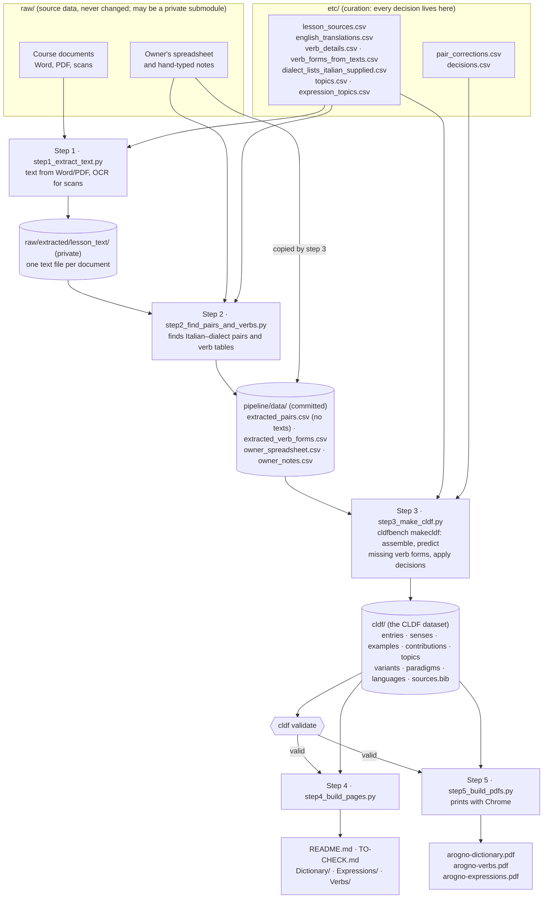

# The build pipeline

This folder turns the source documents in [`../raw/`](https://github.com/michaelmaguire/languages-dialett-raw), together with the curation in
[`../etc/`](../etc/), into a [CLDF](https://cldf.clld.org/) dataset in [`../cldf/`](../cldf/), and then
into everything you read: the dictionary, expression and verb pages, `TO-CHECK.md`, the main `README.md`,
and the four PDFs. One command rebuilds the lot:

```sh
pipeline/build_all.sh
```

## How the data flows



In words:

| Step | Script | Reads | Writes |
|---|---|---|---|
| 1 | `step1_extract_text.py` | `../raw/*.docx`, `*.pdf`, `*.txt` | `../raw/extracted/lesson_text/*.txt` (cached by file hash; private); new rows in `../etc/lesson_sources.csv` |
| 2 | `step2_find_pairs_and_verbs.py` | the text, `../etc/lesson_sources.csv`, `../etc/parallel_texts.csv`, `../raw/notes_added_by_hand.csv` | `data/extracted_pairs.csv`, `data/extracted_verb_forms.csv`, `data/unparsed_lines.csv` |
| 3 | `step3_make_cldf.py` → `../cldfbench_rogn.py` → `lexicon.py` | step 2's output, all of `../etc/`, the owner's spreadsheet and notes (from `../raw/`, or without it from the copies `data/owner_*.csv`) | `data/owner_spreadsheet.csv` and `data/owner_notes.csv` (fresh copies, when `../raw/` is there); `../cldf/`, rebuilt from scratch; then checked with `cldf validate`, and the build stops if it is not valid |
| 4 | `step4_build_pages.py` (+ `dictionary_model.py`, `expressions_model.py`, `verbs_model.py`, `grammar_model.py`) | `../cldf/` only | all Markdown pages; the models `cache/*_model.json` (the PDFs print from them); plain-table exports `data/dictionary.csv`, `data/expressions.csv`, `data/verb_tables.csv` |
| 5 | `step5_build_pdfs.py` | `cache/*_model.json` (from step 4) with `templates/dictionary.html.j2`, `expressions.html.j2`, `verbs.html.j2`, `grammar.html.j2`, `templates/cover_*.html`, `../ATTRIBUTIONS.md` | `../Dictionary/arogno-dictionary.pdf`, `../Verbs/arogno-verbs.pdf`, `../Expressions/arogno-expressions.pdf`, `../Grammar/arogno-grammar.pdf` |

### Building without the source documents

`../raw/` holds the course documents, which belong to other people, so it may become a private git
submodule. Only steps 1 and 2 read the documents. Step 3 needs, besides `../etc/`, what step 2 saved in
`data/` (`extracted_pairs.csv`, `extracted_verb_forms.csv`) and the owner's spreadsheet and notes, of which
step 3 keeps a copy in `data/owner_spreadsheet.csv` and `data/owner_notes.csv` on every full build. All of
these are committed. So without `raw/`, `build_all.sh` skips steps 1-2 and still applies every decision in
`../etc/` and rebuilds `../cldf/`, the pages and the PDFs; tested on 2026-10-14 with an empty `raw/`, and
again on 2026-10-28 after the text moved to `raw/`, the output was identical to a full build.
`data/attested_feminines.csv` (the feminines a full build found in the texts: a word list, no text)
stands in for the text there. What needs `raw/`: adding a document, changing how a document is
parsed (`layout` in `lesson_sources.csv`, `pair_corrections.csv` additions that depend on new extraction),
and editing the spreadsheet or notes (edit them in `raw/` and run a full build, which refreshes the copies).
Steps 1 and 2 stop with a message rather than run on an empty `raw/`.

Step 1 is only slow the first time, or when a scanned PDF changes: OCR of all the scans takes over ten
minutes, which is why the extracted text is kept in git, in the private `../raw/extracted/` (owner,
2026-10-28: the material's text is not published here). Step 2 writes its full output there too
(`extracted_pairs.csv`, `unparsed_lines.csv`), and to `data/` a copy of the pairs without the lines of
stories, poems and articles, except the sayings and phrases kept from them. Steps 2 to 5 take under a minute.

## The master data: one direction only

The layout follows [cldfbench](https://github.com/cldf/cldfbench), the standard tool for curating CLDF
datasets:

| Folder | cldfbench role | Who changes it |
|---|---|---|
| `../raw/` | source data | You add documents; nothing ever edits them. May be a private git submodule |
| `../etc/` | curation ("configuration") | You, or Claude in a session: every correction and decision |
| `../cldf/` | the CLDF dataset | Only the build. It is **regenerated from `raw/` + `etc/` on every build** |
| everything else | generated from `../cldf/` | Only the build |

So the dataset in `../cldf/` is the master **result**, and `../etc/` is where the master **decisions**
live. Step 3 reads `raw/` only through files saved in `data/` (the extraction and the copies of the
owner's spreadsheet and notes), which are committed, so the dataset can be rebuilt with every decision
applied even when `raw/` is not available. To change anything, change a document in `raw/` or a file in
`etc/`, then rebuild. Edits made
directly in `cldf/` or in the pages are overwritten.

### Recording a decision

[`../etc/decisions.csv`](../etc/decisions.csv) holds decisions about the dictionary itself, one per row:

```
Decision,Language_ID,Form,Sense,Target_Form,Target_Language_ID,Italian,English,Reason,Date
typo,ticinese,semper,,sempru,rogn,,,"Typo in the owner's spreadsheet; the course writes sempru …",2026-10-14
correct,ticinese,böcc,,,,buco,hole,"Claude inferred: Italian misspelt ""bucco"" in the spreadsheet",2026-10-14
```

| Decision | Effect in the dataset |
|---|---|
| `typo` | The entry is folded into `Target_Form` (in `Target_Language_ID`, if given). The mistaken form is kept in `variants.csv` with status `typo`, so it is recognised but never shown. |
| `reject` | The entry is kept with status `rejected` and the reason, and left off the pages. |
| `accept` | A `pending` (⚠) entry becomes accepted, and its pending senses attested. |
| `variant` | Same variety: the form becomes an accepted spelling of the target entry. Another variety: the entry is linked to the target with `Variant_Of` (or folded into a new target entry if there is none). |
| `correct` | Replaces the dialect, Italian and/or English of an entry (or one `Sense` of it) or of an expression. |
| `expression` | The entry is an idiom, a saying or a sentence, not a word: it leaves the dictionary and becomes an expression, its senses joined as the translation. |

`reject`, `accept` and `correct` also apply to expressions, with their dialect text as `Form`.
`Reason` and `Date` end up in the row's `Comment`; reasons starting "Claude inferred:" are Claude's,
from a review of the whole dataset, and the owner's own decisions do not have that prefix. A decision that matches nothing is reported as a
warning during the build. Other files in `etc/` handle other kinds of decision; see
[`../etc/README.md`](../etc/README.md).

## What is in each folder of `pipeline/`

| File or folder | What it is |
|---|---|
| `build_all.sh` | Runs steps 1–5 and regenerates `../cldf/README.md`; creates `.venv` with `openpyxl`, `pycldf`, `cldfbench` and `pypdf` on first run. |
| `paths.py` | Where `raw/`, `etc/`, `cldf/` and the rest are; every script uses it. |
| `step1_extract_text.py` | Word and PDF text, OCR for scans; registers new documents in `../etc/lesson_sources.csv`. |
| `step2_find_pairs_and_verbs.py` | Finds pairs (word lists, alternating lines, two sentences on one line, bullets, tables) and verb tables. Decides which side is dialect by scoring both against an Italian word list. Aligns a class translation with its Italian original in another document (`../etc/parallel_texts.csv`): sentence by sentence or line by line, scoring shared word roots and length; a weak match is marked ⚠. |
| `step3_make_cldf.py` | Runs the dataset's `makecldf` through cldfbench (see the decisions below for why not the command line). |
| `lexicon.py` | The conversion to CLDF: builds entries, senses, examples, variants and paradigms, applies `../etc/decisions.csv`, places each expression in its document with a genre and topic (`place_examples`), links senses to the expressions that use them (`link_examples`), declares the metadata; also reads the dataset back for steps 4 and 5. |
| `grammar.py` | The grammar: reads `../etc/grammar/` and `../etc/grammar_examples.csv`, adds the examples (genre `grammar`) and the chapters (`cldf/grammar/`, `media.csv`) to the dataset for step 3, checks every example against its source line, and renders the chapters as Markdown (step 4, `../Grammar/`) and as HTML for the PDF (step 5). Its docstring describes the chapter format. |
| `verb_conjugator.py` | Predicts missing verb forms from the model paradigms in lessons 8, 17 and 18. A form found in a document always wins over a prediction. |
| `step4_build_pages.py` | Writes all the Markdown. Also holds `assemble()`, which gathers steps 1–2 and `etc/` for step 3, and shared helpers. |
| `step5_build_pdfs.py` | Lays out and prints the four PDFs: cover, contents, attributions, then the content. Each PDF is printed twice: the contents page links to every section, and the second print fills in the page numbers that `pypdf` reads from the first. In the dictionary, the senses of one headword share a line (`anca` *anche · as well; pure · also*), and a sense whose words are all contained in another of the same headword and region is not repeated. |
| `tool_missing_english.py` | `list` prints entries without English; `merge FILE` adds `id<TAB>english` lines to `../etc/english_translations.csv`. |
| `tool_expression_topics.py` | `list` prints expressions without a topic (after a build); `merge FILE` adds `n<TAB>topic` lines to `../etc/expression_topics.csv`. |
| `tool_review_verbs.py` | `OUT.pdf essere avere …` prints the sheets of the named verbs (Italian infinitives, in that order), one per page as in the verbs PDF, for the teacher to correct by hand. Not part of the build. |
| `tool_rename_sources.py` | Applies the renames logged in `../raw/renamed_files.csv` (by `../raw/fetch_mail_attachments.py`) to every hand-written file that names a document (`../etc/`, `lexicon.py`, the docs) and to the extraction cache, so nothing is extracted again. `--dry-run` counts only. Run it, then build. |
| `tool_flashcards.py` | `OUT.apkg [--decks words,verbs,expressions] [--verbs pagare,…] [--inferred]` writes Anki flashcards from `../cldf/`, English → Dialett and Dialett → English: every dictionary word (all regions, region on the card), the verb forms found in the documents (`--inferred` adds the † ones, tagged), and the expressions by topic. Note ids come from the CLDF IDs, so re-importing a rebuilt deck updates the cards and keeps their review history. Not part of the build; see `../ANKI-FLASHCARDS.md`. |
| `templates/` | `readme_intro.md` (top of the main `README.md`), `cldf_readme_intro.md` (top of `cldf/README.md`), `cover_verbs.html`, `cover_dictionary.html`, `cover_expressions.html`, `cover_grammar.html`. |
| `cache/` | Working files only: `print_*.html`, `missing_english_todo.csv`, `expression_topics_todo.csv`. The extracted text is in the private `../raw/extracted/`. |
| `data/` | Committed. Step 2's public extraction (`extracted_pairs.csv` without the lines of texts, `extracted_verb_forms.csv`), `attested_feminines.csv`, step 3's copies of the owner's spreadsheet and notes (`owner_*.csv`), and step 4's plain-table exports. The first two groups are step 3's input when `../raw/` is not available: keep them in git. |

## How updates work

| You want to… | Do this, then run `build_all.sh` |
|---|---|
| Add a new document | Put it in `../raw/` (from e-mail: `../raw/fetch_mail_attachments.py`, then `tool_rename_sources.py` if it renamed anything), build once, then fill in its row in `../etc/lesson_sources.csv` (including `genre`) and build again. Then add English with `tool_missing_english.py` and topics with `tool_expression_topics.py`. |
| Move a saying or sentence out of the dictionary | Add an `expression` row to `../etc/decisions.csv` and its topic to `../etc/expression_topics.csv`. |
| Change an expression's topic, or mark one as a saying | Edit its row in `../etc/expression_topics.csv` (`Topic`, `Genre`). |
| Add words from your own notes | Add rows to `../raw/notes_added_by_hand.csv`. |
| Mark a form as a typo, reject, accept or correct an entry or expression, link variants | Add a row to `../etc/decisions.csv`. |
| Remove or correct a wrongly extracted pair | Find its `source` and `line` in `../raw/extracted/extracted_pairs.csv` and add a row to `../etc/pair_corrections.csv`. |
| Correct an English translation | Edit the row in `../etc/english_translations.csv`. |
| Give a verb its infinitive, or fix a predicted form | Edit `../etc/verb_details.csv`, or add the form to `../etc/verb_forms_from_texts.csv` with `basis` = `attested`. |
| Treat a document differently | Change its `layout`, `include` or `canonical` value in `../etc/lesson_sources.csv`. |
| Change a cover or a README introduction | Edit the file in `templates/`. |

After a build, read the summary it prints (entries, senses, examples, found versus inferred verb forms,
entries without English, any decision that matched nothing), and look at the `git diff` of `../cldf/`
and of the pages: a change to an input should only change what you expected.

## Decisions made in this implementation

- **Rebuildable without the sources.** Every input of step 3 is in this repo (`../etc/`, `data/extracted_*.csv`,
  `data/owner_*.csv`), so the dataset, pages and PDFs can be regenerated, and decisions applied, without the
  documents in `../raw/`; only steps 1-2 need them (see "Building without the source documents").
- **cldfbench workflow, not a hand-edited master.** The dataset is rebuilt from `raw/` + `etc/` every
  time, so it is always consistent and valid, and every decision is a reviewable row in `etc/`. Chosen on
  2026-10-14 over merging new material into a hand-edited dataset, which would have needed a fragile
  merge step.
- **Step 3 calls cldfbench's Python interface instead of `cldfbench makecldf`.** The command line insists
  on a local copy of the Glottolog catalogue (a large download). This dataset does not use it: its
  language codes are set by hand in `lexicon.py` (Glottocode `lomb1257` and ISO 639-3 `lmo` for every
  Ticinese variety, which Glottolog does not subdivide; `ital1282` Italian, `stan1293` English).
  `step3_make_cldf.py` runs exactly the same `cmd_makecldf` and the same writer, which records provenance
  in the metadata and writes `cldf/requirements.txt`. If the catalogue is ever installed
  (`cldfbench catconfig`), `cldfbench makecldf ../cldfbench_rogn.py` works as well.
- **IDs are derived from the content**, in the form CLDF requires (`[a-zA-Z0-9_-]+`): an entry's ID is
  its headword (`sempru`), with the variety appended outside Rögn (`semper-ticinese`) and a number for
  homographs. Because the dataset is regenerated, an ID stays the same as long as the data it comes
  from does.
- **Nouns have a bare headword, a gender and a plural.** After the decisions, `noun_forms()` in `lexicon.py`
  takes the article off a noun's headword (`ul/un purcel` becomes `purcel`, Part_Of_Speech `noun`), sets
  `Gender` from the article (ul, al, un: m; la, na: f; for an elided `l’`, from the Italian or
  `../etc/nouns.csv`) and `Plural` from the source (`al tecc / i tecc`, lesson 6's `i purcei`), else
  predicted by `noun_plurals.py` (82 of the 90 plurals the course gives are predicted correctly; the misses are
  consonant doublings such as `poma → pomm`). The Italian and English of its senses lose their article too.
  A leading `al`/`la`/`l’` counts as an article only when it is a pair (`ul/un`) or the Italian also has
  one, so the subject clitic in `al piöf` (piove) or `l’è sofic` stays. `Gender` and `Plural` are custom
  columns (CLDF has no terms for them); the source form stays in `variants.csv` as Kind `article`. Pages
  and PDF print *m., pl. purcei* after every noun. Corrections go in `../etc/nouns.csv`.
- **A word written with or without its article is one entry.** `piöcc` (the owner's spreadsheet) and
  `ul/un piöcc` (lesson 6) both become `piöcc` and are merged by `noun_forms()`: the Rögn entry is kept and
  the other form stays in `variants.csv` (Kind `article`). Verbs are never merged (`na föra` is the verb
  "go out"). The build prints each merge. In the Dialett look-up an article pair such as `ul/un` is not
  treated as two spellings, so it produces no cross-reference row.
- **Homographs are separate entries.** The verb `vert` (to open) and the colour `vert` (green) are two
  entries. A word pair is attached to a verb's entry only when its Italian is one of that verb's
  infinitives (`andare = na`).
- **Look-ups give the Rögn word.** From Italian or English (`italiano.md`, `english.md` and those
  parts of the PDF), an entry from another region is left out when a Rögn entry has the same Italian or
  the same English. The Dialett direction lists everything, with its region. The English pages show
  English, then Dialett, then Italiano.
- **One row per headword.** In all three dictionary pages and the PDF, the senses and regional forms of a
  word share one row (in the Markdown tables, one line each inside the cells). A form whose words are all
  contained in another form of the same region is not repeated (`tütt` beside `tütt, tücc`). The logic is
  `merge_same_head()` in `step4_build_pages.py`, used by both steps 4 and 5.
- **Expressions are grouped by topic; texts are not reprinted.** Every expression is tied to its document and line
  (`contributions.csv`, `Contribution_ID`, `Position`: the CLDF TextCorpus pattern), and has a genre
  (`phrase`, `saying`, `exercise`, `text`) from its document in `../etc/lesson_sources.csv` unless
  `../etc/expression_topics.csv` says otherwise. Every expression that is not part of a text has a topic
  from `../etc/topics.csv`; the pages and the PDF list each topic's sayings, then its phrases. The lines of
  texts (poems, stories, articles, dialogues) are not published: on no page or PDF, and not in `../cldf/`;
  a saying or phrase from one is kept by giving it a row, genre and topic in `../etc/expression_topics.csv`. A sense's `Example_IDs` lists the Rögn expressions that contain the dialect word
  (or a form of the verb) and whose Italian contains the sense's Italian stem.
- **Verbs appear in the dictionary**, with their English as an infinitive (`to go`), and a verb's main
  Italian infinitive is its sense without a comment (synonyms carry "Italian synonym of …").
- **Nothing is deleted.** Rejected entries and typos stay in `cldf/` with their reason and sources; the
  pages leave them out.
- **"?" in the owner's spreadsheet means "not known yet"** and is read as blank. An entry with neither
  Italian nor English (`tarlücc`) gets the Description `[?]`, status `pending`, and is listed at the end of
  `italiano.md` under "No Italian yet"; the PDF leaves an entry out of a look-up direction whose word it lacks.
- **The Italian is the sense `Description`** (CLDF requires a description), English the added
  `Description_English`. An entry whose source gives no Italian has its English in brackets and is
  `pending`.

## Requirements

Python 3 with `python3-venv`, `poppler-utils`, `tesseract-ocr` with the `ita` and `deu` models,
`hunspell-it`, and Chrome or Chromium for the PDFs. Python packages (`openpyxl`, `pycldf`, `cldfbench`, `pypdf`)
are installed into `.venv` by `build_all.sh`. The install command is in the main
[`README.md`](../README.md#requirements).
